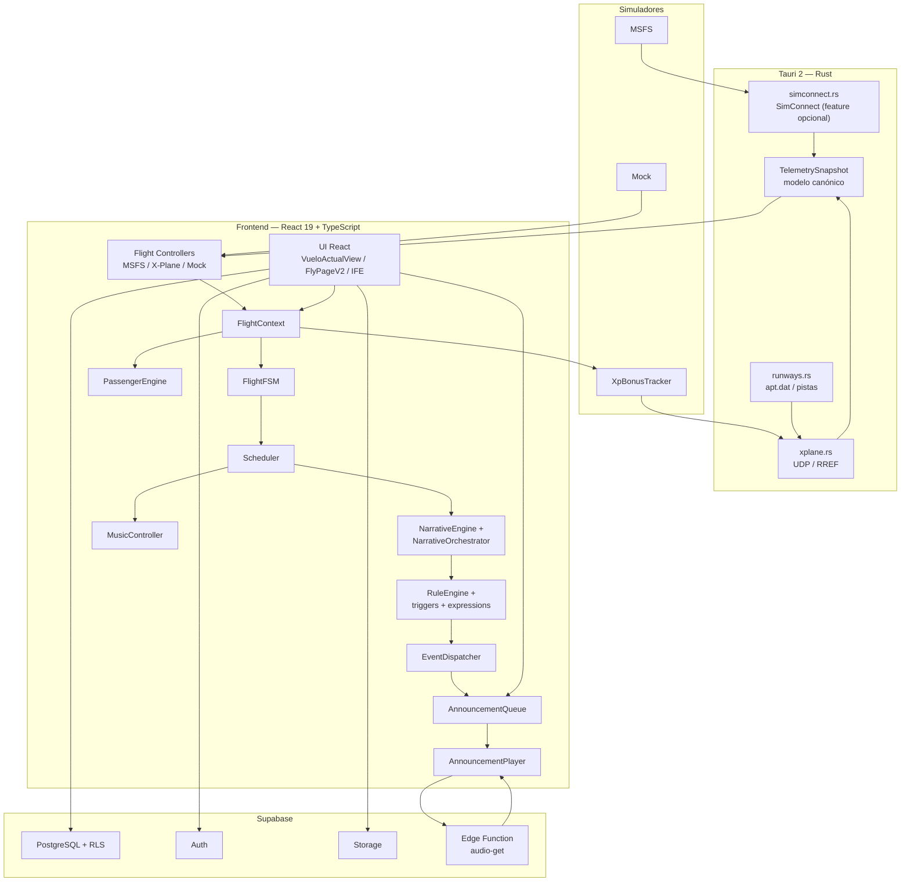

# Stack Tecnológico — Announs Desktop

**Última actualización:** 2026-10-20  
**Repositorio:** `C:\Proyectos\Announs`  
**Producto:** Announs Desktop  
**Tipo de aplicación:** aplicación de escritorio compañera para simuladores de vuelo (MSFS y X-Plane 12), con generación y reproducción de anuncios de cabina, telemetría, pasajeros, campañas y progresión.

---

## 1. Resumen ejecutivo

Announs Desktop es una aplicación de escritorio construida con **Tauri 2** como contenedor nativo y un frontend **React 19 + TypeScript + Vite 6**. La lógica de simulación y narrativa vive principalmente en el frontend, mientras que el backend Rust de Tauri actúa como puente con los simuladores:

- **MSFS** mediante SimConnect.
- **X-Plane 12** mediante UDP/RREF.
- **Mock** para desarrollo y modo pruebas.

La persistencia, autenticación, almacenamiento de archivos y la generación de audio con IA se delegan a **Supabase** (PostgreSQL, Auth, Storage y Edge Functions). La app no utiliza Electron, Next.js ni un servidor Node propio en producción.

---

## 2. Ficha técnica

| Elemento | Valor actual |
|---|---|
| Nombre del producto | Announs |
| Identificador Tauri | `net.announs.app` |
| Versión frontend (`package.json`) | `0.11.0` |
| Versión Tauri (`tauri.conf.json`) | `0.10.0` |
| Versión backend (`Cargo.toml`) | `0.10.0-alpha` |
| Shell de escritorio | Tauri 2.11.2 |
| Frontend | React 19.0.1 + React DOM 19.0.1 |
| Lenguaje frontend | TypeScript 5.8 |
| Bundler | Vite 6.2.3 |
| Estilos | Tailwind CSS 4.1.14 |
| Backend nativo | Rust, edición 2021 |
| Runtime WebView | WebView2 en Windows; WebKit en macOS/Linux |
| Base de datos / backend cloud | Supabase (PostgreSQL + Auth + Storage + Edge Functions) |
| Simuladores soportados | MSFS, X-Plane 12, Mock |
| Idiomas de interfaz | Español e inglés |

> Las versiones de `package.json`, `tauri.conf.json` y `Cargo.toml` no están unificadas actualmente. Se documentan tal como figuran en el repositorio.

---

## 3. Arquitectura de alto nivel



### Flujo principal

1. El controlador de simulador recibe telemetría y la normaliza a `TelemetrySnapshot`.
2. `FlightContext` centraliza el estado operacional.
3. `FlightFSM` valida las transiciones de fase.
4. `Scheduler` orquesta escenarios, timers, narrativa, reglas, anuncios y música.
5. El evento narrativo se resuelve como un anuncio concreto.
6. `AnnouncementQueue` y `AnnouncementPlayer` solicitan el audio a la Edge Function `audio-get`.
7. El audio se reproduce en el frontend; la UI y los motores de pasajeros/XP consumen el mismo estado.

---

## 4. Stack por capas

### 4.1 Escritorio y backend nativo

| Tecnología | Uso |
|---|---|
| **Tauri 2.11.2** | Shell de escritorio, ventana nativa, IPC y empaquetado. |
| **Rust 2021** | Puentes de telemetría, pistas y comandos nativos. |
| **tauri-plugin-shell** | Integración con shell del sistema. |
| **tauri-plugin-log** | Logging nativo en builds de desarrollo. |
| **SimConnect SDK** (`simconnect-sdk`) | Puente real con MSFS, detrás de la feature `simconnect`. |
| **UDP/RREF** | Puente de solo lectura con X-Plane 12. |
| **apt.dat parser** | Lectura de pistas y rampas de X-Plane. |

Comandos Tauri expuestos:

- `simconnect_connect`, `simconnect_disconnect`, `simconnect_subscribe`, `simconnect_poll`, `simconnect_emit_telemetry`.
- `xplane_connect`, `xplane_disconnect`, `xplane_subscribe`, `xplane_poll`, `xplane_emit_telemetry`.
- `get_runways`.

Características de Cargo:

- `xplane-udp`: habilitada por defecto.
- `simconnect`: opcional; requiere MSFS SDK, LLVM/libclang y `LIBCLANG_PATH`.
- `run.bat` y `build.bat` compilan con `--features simconnect`.
- La telemetría se emite a aproximadamente **10 Hz** (throttle de 100 ms).

### 4.2 Frontend

| Tecnología | Uso |
|---|---|
| **React 19** | Interfaz y composición de vistas. |
| **TypeScript 5.8** | Tipado estático; `tsc --noEmit` como lint. |
| **Vite 6** | Desarrollo, HMR y build de producción. |
| **Tailwind CSS 4** | Estilos utilitarios mediante `@tailwindcss/vite`. |
| **Lucide React** | Iconografía. |
| **Motion** | Animaciones y transiciones. |
| **Recharts** | Gráficos de telemetría y resultados. |
| **Leaflet** | Mapas interactivos de ruta y recorrido. |
| **react-simple-maps + world-atlas** | Mapas geográficos y visualizaciones de rutas. |
| **i18next + react-i18next** | Internacionalización español/inglés. |
| **i18n-iso-countries** | Nombres de países y códigos ISO. |

Características de la UI:

- No hay router externo: la navegación principal se resuelve en `App.tsx` con estado.
- No hay Redux/Zustand: el estado se maneja con hooks, clases de dominio y contextos propios.
- Se mantienen vistas vivas con `keep-alive` para no destruir motores de vuelo al navegar.
- El sandbox V2 (`FlyPageV2`, `flight-v2`, `fly-v2`) convive con la vista estable `VueloActualView`.

### 4.3 Dominio de vuelo y narrativa

| Componente | Responsabilidad |
|---|---|
| `FlightController` | Contrato común para MSFS, X-Plane y Mock. |
| `FlightContext` | Estado operacional y datos del vuelo. |
| `FlightFSM` | Máquina de estados de fases de vuelo. |
| `Scheduler` | Orquestador de fase, narrativa, timers, anuncios y música. |
| `ScenarioLoader` / `ScenarioResolver` | Carga y resolución de escenarios. |
| `NarrativeEngine` / `NarrativeOrchestrator` | Ejecución de pasos narrativos. |
| `RuleEngine` | Evaluación de reglas operativas. |
| `triggers/` | Disparadores por fase, condición, temporizador y manual. |
| `expressions/` | Evaluación de expresiones de telemetría y variables. |
| `dispatcher/` | Despacho de eventos a handlers. |
| `AnnouncementQueue` / `AnnouncementPlayer` | Cola y reproducción de anuncios. |
| `PassengerEngine` | Simulación de satisfacción, calma, confort, entretenimiento, hambre y miedo. |
| `XpBonusTracker` | Bonificaciones XP por disciplina y eventos del vuelo. |
| `FlightPathRecorder` | Grabación del recorrido y persistencia GeoJSON. |
| `MusicController` | Música de embarque, loop, ducking y fade. |

### 4.4 Datos y servicios cloud

| Tecnología | Uso |
|---|---|
| **Supabase JS 2.108** | Cliente de base de datos, Auth, Storage y Edge Functions. |
| **PostgreSQL + RLS** | Persistencia de vuelos, usuarios, configuración y catálogos. |
| **Supabase Auth** | Sesión de usuario. |
| **Supabase Storage** | Avatares, música, paquetes y recursos. |
| **Supabase Edge Functions** | Generación/entrega de audio (`audio-get`). |
| **Supabase CLI** | Migraciones y despliegue de Edge Functions. |

Migraciones presentes en `supabase/migrations/`, entre otras:

- escenarios (`scenario_key`),
- fotos de sesión,
- aeropuertos y pistas,
- XP de campañas y satisfacción de pasajeros,
- entregas de audio (`flight_audio_deliveries`),
- paquetes comunitarios,
- ritmo de embarque,
- distorsión y fuente de música de embarque.

Tablas relevantes observadas en el código:

- `flights`
- `flight_paths`
- `flight_setting_announcements`
- `flight_audio_deliveries`
- `setting_general`
- `boarding_music`
- `aircraft_types`
- `cabin_layouts`
- `airports`
- `campaigns`
- `packages`
- `languages`
- `voices`

### 4.5 Audio e IA

- La generación de voz y la entrega de audio se realizan mediante la Edge Function **`audio-get`**.
- El frontend invoca la función con `supabase.functions.invoke("audio-get", ...)`.
- `AnnouncementService` reproduce el audio devuelto con `HTMLAudioElement`.
- `MusicController` reproduce música de embarque desde el catálogo `boarding_music`, con versiones procesada/limpia, loop, ducking durante anuncios y fade out.
- `MusicCacheService` cachea audio para evitar descargas repetidas.
- El video de seguridad puede reproducirse como PACK dentro del IFE.
- `@google/genai` figura en `package.json`, pero no se importa directamente desde `src/`; la integración de IA queda del lado de las Edge Functions.

---

## 5. Integración con simuladores

### MSFS

- Controlador frontend: `MsfsFlightController`.
- Puente nativo: `src-tauri/src/simconnect.rs`.
- Comunicación: Tauri `invoke` + evento `telemetry`.
- SimVars principales: altitud, velocidad, rumbo, posición, motores, freno de parking, puertas, cinturones, ATC, pista, pushback, luces, tiempo y clima.
- Requiere compilar con la feature `simconnect` para usar el SDK real.

### X-Plane 12

- Controlador frontend: `XPlaneFlightController`.
- Puente nativo: `src-tauri/src/xplane.rs`.
- Protocolo: UDP/RREF, solo lectura.
- Host por defecto: `127.0.0.1`.
- Puerto RX por defecto: `49000`.
- Puerto local por defecto: `49005`.
- Emisión aproximada: 10 Hz.
- Pistas y rampas: `runways.rs` lee `apt.dat` y el frontend calcula la geometría con `RunwayGeometry.ts`.

### Mock

- Controlador frontend: `MockFlightController`.
- Permite desarrollo sin simulador y modo pruebas.
- Timeline de fases con multiplicador de velocidad (`VITE_MOCK_SPEED`).
- Mantiene GATE hasta que el usuario inicia el embarque.
- Mantiene BOARDING hasta que el usuario pulsa “Cerrar Puertas”.

---

## 6. Persistencia y flujo de datos

```text
Simulador
  → FlightController
  → TelemetrySnapshot
  → FlightContext
  → FlightFSM / Scheduler
  → Narrative / Rules / Dispatcher
  → AnnouncementQueue
  → AnnouncementPlayer
  → Edge Function audio-get
  → Audio
```

En paralelo:

```text
FlightContext + telemetría
  → PassengerEngine
  → métricas de satisfacción
  → UI de cabina / resumen final

FlightPathRecorder + XpBonusTracker
  → Supabase (flights, flight_paths, XP)
```

---

## 7. Build, desarrollo y verificación

### Requisitos

- Node.js y npm.
- Rust y Cargo.
- Tauri CLI.
- En Windows: WebView2 y Visual Studio Build Tools.
- Para SimConnect: MSFS SDK, LLVM/libclang y `LIBCLANG_PATH`.
- Para Supabase: acceso al proyecto y Supabase CLI.

### Comandos habituales

```bash
npm install
npm run dev
npx tauri dev
npx tauri dev --features simconnect
npm run build
npx tauri build
npm run lint
```

En Windows también existen:

- `run.bat`: launcher de desarrollo, producción o compilación del backend.
- `build.bat`: inicializa Visual Studio, configura `LIBCLANG_PATH` y compila con `simconnect`.

### Verificación

No hay un runner de tests unitarios convencional. La validación se apoya en:

- `npm run lint` → `tsc --noEmit`.
- `scripts/flight-v2-sandbox-flight.verify.ts`.
- `scripts/p0-special-event-skip.verify.ts`.
- `scripts/passenger-engine.verify.ts`.
- `scripts/xplane-runway-geometry.verify.ts`.
- `scripts/xplane-runway-provider.verify.ts`.
- `npm run verify:p0-special` y `npm run verify:passenger`.
- `npm run build` para validar el bundle de Vite.

---

## 8. Variables de entorno relevantes

Variables leídas por `src/config.ts` y el cliente de Supabase:

| Variable | Uso |
|---|---|
| `VITE_SUPABASE_URL` | URL del proyecto Supabase. |
| `VITE_SUPABASE_ANON_KEY` | Clave anónima del cliente Supabase. |
| `VITE_SIM_PROVIDER` | Proveedor por defecto: `msfs`, `xplane` o `mock`. |
| `VITE_SIM_AUTOCONNECT` | Conexión automática al simulador. |
| `VITE_SIM_POLL_INTERVAL` | Intervalo de polling en ms. |
| `VITE_MOCK_ENABLED` | Habilita el simulador Mock. |
| `VITE_MOCK_SPEED` | Multiplicador de velocidad del Mock. |
| `VITE_MOCK_AUTO_TRANSITION` | Transiciones automáticas del Mock. |
| `VITE_MOCK_AUTO_START` | Arranque automático del Mock. |

La generación de IA requiere configuración del lado de Supabase/Edge Function. No se deben incorporar claves privadas al bundle del frontend.

---

## 9. Estructura del repositorio

```text
Announs/
├─ src/                     Frontend React + TypeScript
│  ├─ components/           UI, vuelo, IFE, música, paquetes
│  ├─ pages/                FlyPageV2, VueloActualView, etc.
│  ├─ services/             Controladores, scheduler, Supabase, audio, XP
│  ├─ narrative/            Motor narrativo
│  ├─ scenarios/            Escenarios de vuelo
│  ├─ rules/                Reglas operativas
│  ├─ triggers/             Evaluadores de disparadores
│  ├─ expressions/          Evaluación de expresiones
│  ├─ dispatcher/           Despacho de eventos
│  ├─ passengers/           Motor de pasajeros y arquetipos
│  ├─ engine/               FSM y manifiesto
│  ├─ data/                 Catálogos locales (aerolíneas, nombres)
│  ├─ locales/              Traducciones es/en
│  ├─ types/                Tipos compartidos
│  └─ utils/                Utilidades
├─ src-tauri/               Backend Rust / Tauri
│  ├─ src/simconnect.rs     Puente MSFS
│  ├─ src/xplane.rs         Puente X-Plane UDP
│  ├─ src/runways.rs        Pistas apt.dat
│  ├─ src/telemetry.rs      Modelo canónico
│  └─ tauri.conf.json       Configuración de la app
├─ supabase/migrations/     Migraciones SQL
├─ scripts/                 Verificaciones y utilidades
├─ docs/                    Documentación técnica
└─ public/                  Recursos estáticos
```

---

## 10. Decisiones técnicas destacables

- **Tauri en lugar de Electron:** menor peso, backend Rust y mejor integración nativa con Windows.
- **Telemetría unificada:** MSFS y X-Plane emiten el mismo `TelemetrySnapshot`; el frontend no necesita adaptadores por simulador.
- **Núcleo de dominio desacoplado de la UI:** motores de pasajeros, reglas, narrativa, XP y música son clases independientes.
- **Supabase como backend:** evita mantener un servidor propio para auth, datos, storage y generación de audio.
- **Modo Mock y modo pruebas:** permiten desarrollar y validar el flujo completo sin simulador.
- **Persistencia local de preferencias:** selección de proveedor, idioma, música, escenario y ajustes menores usan `localStorage`.
- **Build con Vite + Tauri:** Vite genera `dist/`; Tauri lo empaqueta con el binario Rust.

---

## 11. Observaciones y deuda técnica

- Las versiones de frontend, Tauri y Cargo no están alineadas.
- El `README.md` actual parece heredado de AI Studio y no describe el producto real.
- `express` y `dotenv` figuran como dependencias, pero no forman parte del runtime Tauri observado en `src/`.
- `@google/genai` no se importa directamente en el frontend; la IA se resuelve en Supabase.
- El script `npm run clean` usa `rm -rf`, poco portable en Windows.
- No hay runner de tests unitarios; la cobertura se basa en scripts de verificación y `tsc`.
- La CSP de Tauri está deshabilitada (`csp: null`).
- La feature `simconnect` no se compila por defecto; requiere toolchain y SDK adicionales.
- La documentación de la Edge Function `audio-get` no vive en este repositorio; se despliega con Supabase CLI.

---

## 12. Glosario

| Término | Significado |
|---|---|
| **Tauri** | Framework de aplicaciones de escritorio con backend Rust y frontend web. |
| **SimConnect** | API de integración con Microsoft Flight Simulator. |
| **RREF** | Protocolo de lectura de DataRefs de X-Plane por UDP. |
| **FlightContext** | Estado operacional centralizado del vuelo. |
| **FSM** | Máquina de estados finitos de fases de vuelo. |
| **Scheduler** | Orquestador de narrativa, reglas, timers y anuncios. |
| **IFE** | In-Flight Entertainment; pantalla de entretenimiento a bordo. |
| **RLS** | Row Level Security de PostgreSQL/Supabase. |
| **Edge Function** | Función serverless de Supabase. |
| **XP** | Puntos de experiencia del piloto. |
